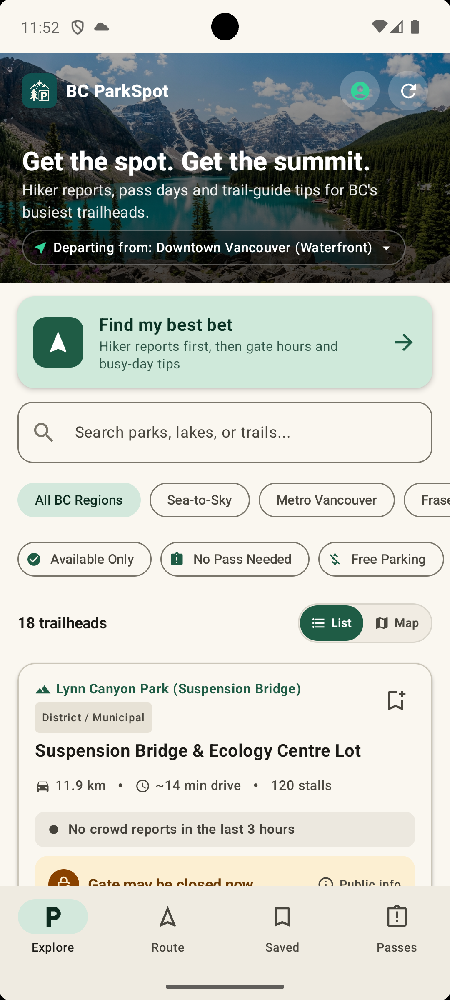
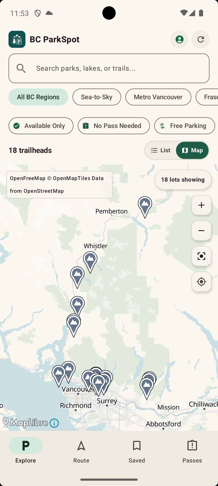
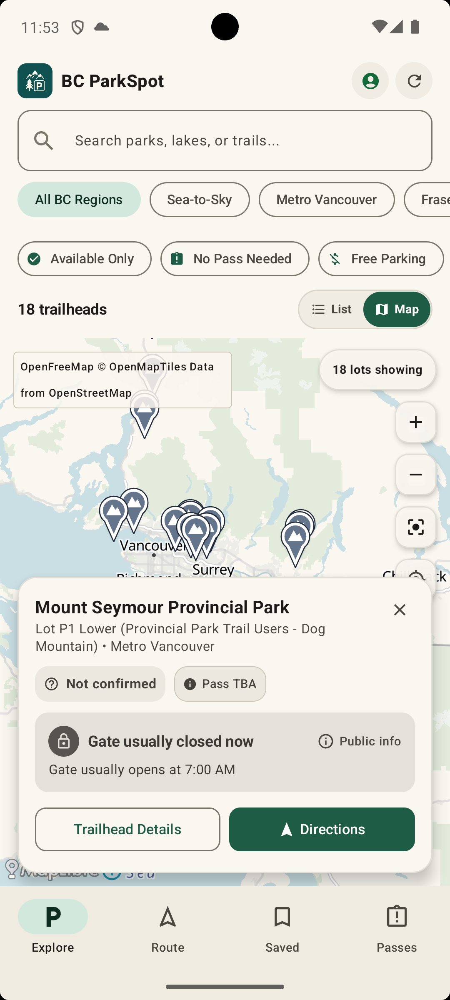
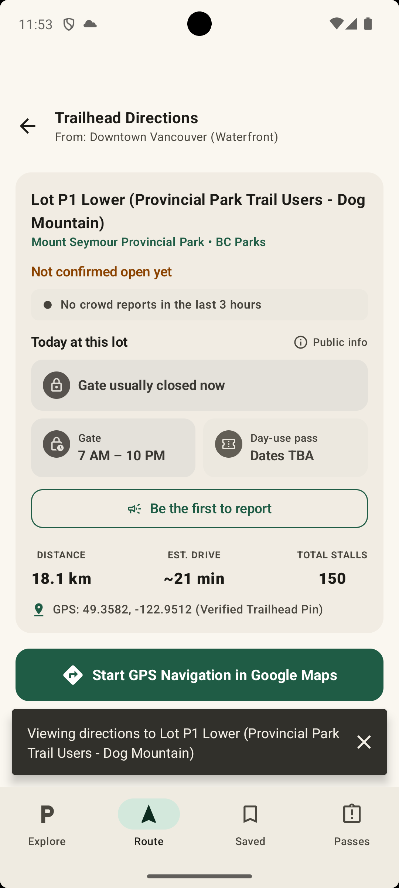
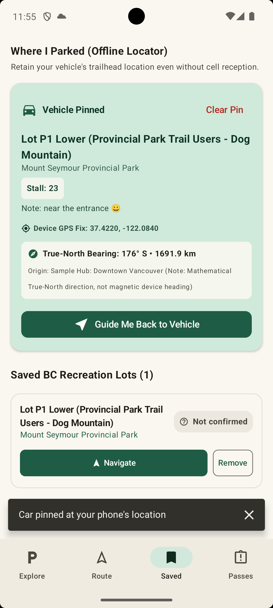
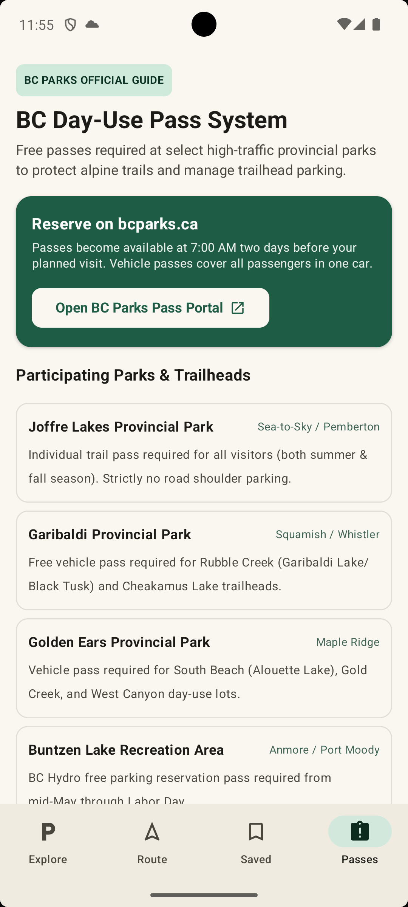
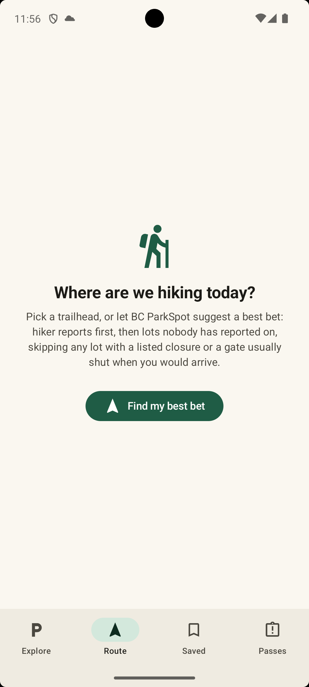
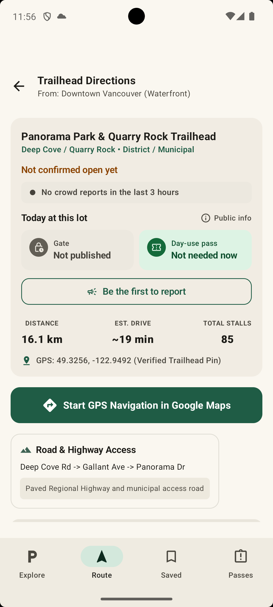
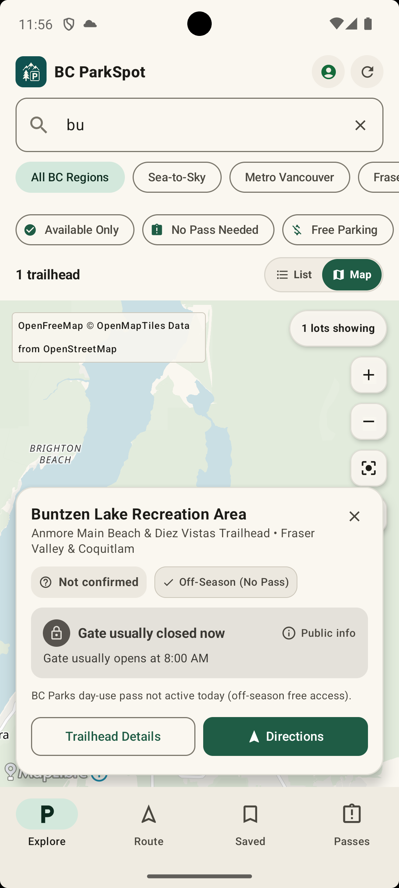
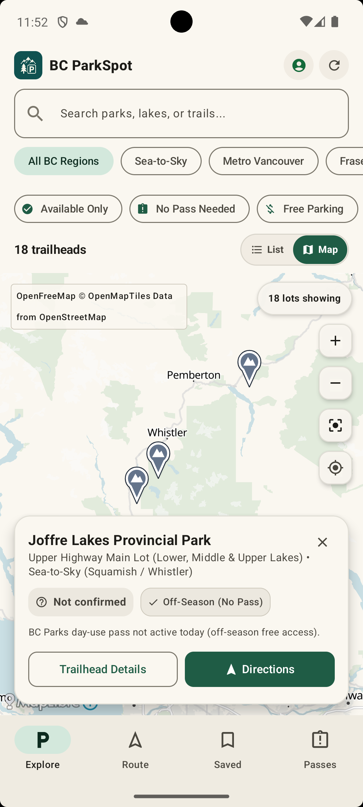

# BC ParkSpot

An Android app that shows trailhead parking across British Columbia parks, combining hiker reports with park pass rules, gate hours and sourced busy-day tips.

**Status: in development.**
The app is not on Google Play, and no live backend ships with this repository.
Pass rules, lot details and busy-day tips can go out of date, so always confirm them with the park authority before you travel.

## Preview

<table>
  <tr>
    <td align="center" valign="top"><br><sub>Browse 18 trailhead lots with live status</sub></td>
    <td align="center" valign="top"><br><sub>Or see them as pins on a map</sub></td>
    <td align="center" valign="top"><br><sub>Tap a pin for gate and pass info</sub></td>
  </tr>
  <tr>
    <td align="center" valign="top"><br><sub>Today at this lot: gate hours and pass rule</sub></td>
    <td align="center" valign="top"><br><sub>Pin your car and find it offline</sub></td>
    <td align="center" valign="top"><br><sub>Which parks need a day-use pass</sub></td>
  </tr>
</table>

<details>
<summary>More screenshots</summary>

<table>
  <tr>
    <td align="center" valign="top"><br><sub>Let the app pick a best bet</sub></td>
    <td align="center" valign="top"><br><sub>A lot with no published gate hours</sub></td>
  </tr>
  <tr>
    <td align="center" valign="top"><br><sub>Search narrows the map</sub></td>
    <td align="center" valign="top"><br><sub>Off-season: no pass needed</sub></td>
  </tr>
</table>

</details>

## Quick start

You need Android Studio, or a JDK from version 17 to 21 with the Android SDK.

```bash
git clone https://github.com/ZhaoruiXu/bc-parkspot.git
cd bc-parkspot
./gradlew :app:installDebug   # with an emulator or phone connected
```

A fresh clone builds and runs with no keys or extra files.
Sign-in, sync and shared reports stay off until you add your own Firebase project.

**[BUILD_SETUP.md](BUILD_SETUP.md)** has the full step-by-step guide: installing the tools, creating an emulator, running the app, a tour of what to try, running the tests, and a map of the code for building on top of it.

## Features

- **Offline lot guide:** 18 lots across Sea-to-Sky, Metro Vancouver and the Fraser Valley, bundled with the app.
- **List or map:** browse lots as a list or as mountain pins on a map, with the same region and pass filters.
  The map needs a connection; the list works offline.
- **Hiker reports:** availability comes only from hiker reports, never from sensors or cameras.
  The app keeps each reporter's latest report from the last 3 hours and shows the lot as Confirmed, Mixed, Unconfirmed or No recent reports, with how many people reported and how old the newest report is.
  A status is confirmed only when at least 2 people agree on the same side (open or full), they outnumber the other side, and nobody on the other side reported more recently.
- **Public info, labelled:** a lot with no recent reports shows what public sources and park rules say about it now, tagged "Public info" and coloured by meaning: a listed closure, a gate that is usually closed or may be closed, a trail guide's arrive-by time on summer weekends, a day-use pass day, or a busy summer season.
  The directions to such a lot add a "Today at this lot" card with today's published gate hours, the pass rule right now and a button to make the first report.
  Lines from a public source claim only what it says and link to it from the lot's detail page; closures, gate hours and pass days come from the lot details in the app; a real report always replaces the line.
- **Find my best bet:** suggests the nearest lot by drive time, trying confirmed-open lots first, then a single open report, then unreported lots no source calls busy (a pass day is a rule, not a busy claim), then other unreported lots.
  It never suggests a lot that has a listed closure, or whose gate is usually or may be shut, or closes within an hour, when you would arrive by the hours bundled in the app.
  Every pick opens directions, and the route screen says when the lot is not confirmed open and shows its current report status and public info.
- **Day-use pass rules:** date, weekday, holiday and time-of-day rules, including BC statutory holidays.
  A park with unpublished dates shows "Pass dates TBA" rather than a guess.
- **Saved lots:** bookmark lots on the device; they survive restarts and app updates.
- **Saved-car locator:** pin your car, then see its distance and true-north bearing, offline.
- **Google Maps navigation:** one tap opens directions to a lot or back to your car.
- **Local-first data:** saved lots, the car pin and your own reports are written to the phone first and sync in the background when you are online.
  You start as a private guest account, and can sign in with Google to keep your data across devices.
  **Delete my data** removes your saved lots, car pin and reports from the phone and the cloud, and removes the account.
- **Light and dark themes:** follow the system, or pick Light or Dark in the account sheet.
  The map is tinted to match.

## Data

- Lot details are written into the app, in `BCParksDataSource.kt`; nothing is fetched from a parks API.
- Each lot links to its source page from its detail screen.
- Lots with a `verifiedAt` date were compared with the source on that date.
  Lots without one are unverified baseline data.
- Busy-day tips are in `FillPatterns.kt`, each with the public source it came from; pass days and closures come from each lot's pass rules.
  A lot no source says anything about shows nothing extra.
- Distances and drive times are estimates from the starting town you pick, not live traffic.
- Community reports stay in Firestore until their author deletes their data.
  The app stops counting a report after 3 hours.
- Map tiles and styles come from [OpenFreeMap](https://openfreemap.org/) (OpenFreeMap © OpenMapTiles Data from OpenStreetMap), rendered with MapLibre.
- The app icon and the banner image were generated with AI.

## Tech

- Kotlin, Jetpack Compose and Material 3
- MapLibre with OpenFreeMap vector tiles
- MVVM with StateFlow
- Pure domain functions for report status, public info and the best-bet choice
- Room as the on-device source of truth, with exported schemas and migration tests
- WorkManager background sync
- Firebase Authentication (anonymous and Google) and Cloud Firestore, with security rules in `firestore.rules`
- JUnit and Robolectric tests

## Licence

MIT. See [LICENSE](LICENSE).
